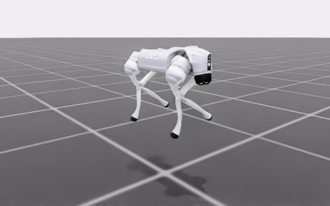
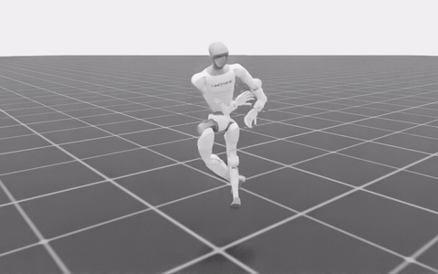
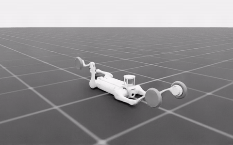
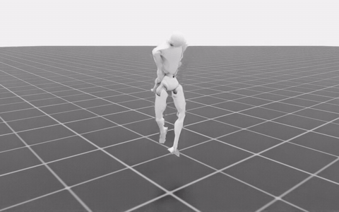
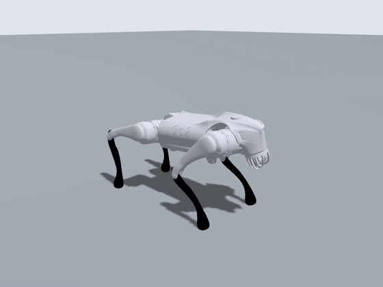
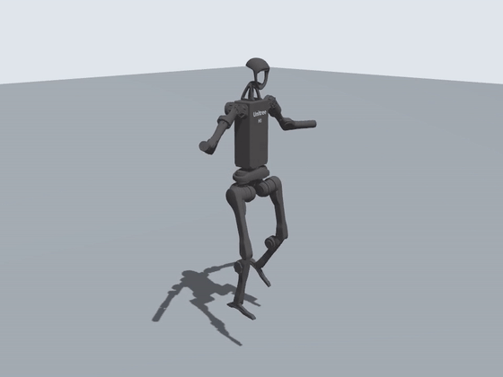

# Simulation qualification evidence for the native ROS 2 Jazzy PR

This branch holds evidence only. It shares no history with the code and is not part of the pull request. Candidate commit: `48f5b9629df9ef37c3ad5a79e4a6cc85df23ad58` (branch `pr/native-jazzy`).

Hosted CI for that commit: https://github.com/yusufdxb/unitree_ros2/actions/runs/43793753044 (Jazzy amd64, Jazzy arm64 on a native arm64 runner, Humble amd64).

All runs used loopback-only DDS (`rmw_cyclonedds_cpp`, private domain IDs) on one x86_64 Ubuntu 24.04 workstation with a system ROS 2 Jazzy install. No physical robot was contacted for any of these runs. Every image comes from the simulator's own renderer or is a text render of captured `ros2` CLI output, and is labelled as such.

## What the simulators test

Each simulator receives the PR's unchanged `unitree_go/LowCmd` or `unitree_hg/LowCmd` on `/lowcmd` from a native Jazzy node. Each simulator publishes the PR's `LowState` on `/lowstate`. The unchanged PR examples `read_low_state` and `read_low_state_hg` decode that stream. The motion numbers compare what a native Jazzy subscriber received with what the commander sent.

Robot models are the official Unitree MJCF files from `unitree_mujoco` (`1eb6642`).

| Robot | Messages | MuJoCo | Isaac Sim 6.0 | Gazebo Harmonic 8.15 |
|---|---|---|---|---|
| GO2 | unitree_go | PASS | PASS | PASS |
| GO2-W | unitree_go | PASS | PASS | PARTIAL (base rolls on free wheels) |
| B2 | unitree_go | PASS | PASS | PASS |
| B2-W | unitree_go | PASS | PASS | PASS |
| H1 | unitree_go | PASS | PASS | PASS |
| G1 | unitree_hg | PASS | PASS | PARTIAL (ankle roll and wrists barely move) |
| H1-2 | unitree_hg | PASS | PASS | PARTIAL (ankle roll and wrist yaw do not move) |
| H2 | unitree_hg | PARTIAL (see below) | PASS | PASS |

Full matrix with notes: [`compatibility_matrix.csv`](compatibility_matrix.csv).

Every PARTIAL is caused by simulator-side behaviour, not by the ROS interface. For H2 in MuJoCo, the existing upstream `h2_ankle_swing_example` publishes on the ROS name `rt/lowcmd`, so it drives nothing. That example is unchanged by this PR. The H2 telemetry and `LowCmd` path pass in all three simulators.

## Isaac Sim 6.0 (IsaacLab 3.0, PhysX, 200 Hz)

The official MJCF is imported by Isaac's own MJCF importer. A test adapter applies the Unitree motor law to PhysX drives from each received `LowCmd`. The law is `tau = tau_ff + kp (q_cmd - q) + kd (dq_cmd - dq)`, capped at the MJCF actuator range.

- **Articulation:** all 8 robots passed 3 of 3 headless cold starts on a gantry fixture (root fixed and lifted). The checks:
  - Every commanded joint moves: GO2 12/12, GO2-W 16/16, B2 12/12, B2-W 16/16, H1 19/19, G1 29/29, H1-2 27/27, H2 31/31.
  - `LowState` arrives at 200 Hz, with the simulation at real-time factor 1.0.
  - The `q` received over ROS equals Isaac's state at the same tick.
  - No joint-limit violation and no NaN.
- **Ground stand:** the PR's own stand examples ran on a free base. Peak heights were GO2 0.34 m, GO2-W 0.39 m (using the GO2 example), B2 0.59 m and B2-W 0.66 m.
- **10-minute soaks:** GO2, G1 and H1 delivered `LowState` at 200 Hz in every minute. No receive gap exceeded 0.2 s, and there were no NaN values.

Data: `metrics/isaac_trials.csv`, `metrics/isaac_joint_displacement_t1.csv` (per joint: commanded vs measured range, correlation, lag) and `metrics/isaac_stand.csv`.

| | |
|---|---|
|  |  |
|  |  |

All Isaac GIFs: [`gifs/isaac/`](gifs/isaac). Stills and `ros2` CLI captures: [`screenshots/isaac/`](screenshots/isaac).

**Limitations:**
- The adapter runs `rclpy` inside Isaac's Python. Isaac's built-in ROS 2 bridge aborts on the fixed-size arrays in `unitree_go/LowState`, and Unitree's `unitree_sim_isaaclab` needs Isaac Sim 6.2.
- Humanoids were tested on a gantry only. Quadrupeds stand but do not walk.
- The adapter does not simulate accelerometer, foot force, battery, CRC or mode fields.
- The rendered trials used for the GIFs run at about 0.6 times real time because of rendering. They are not counted as cold starts.

## Gazebo Harmonic (gz-sim 8.15.0, ros_gz 1.0.24)

The path for each robot:
1. The PR `LowCmd` reaches a test adapter.
2. The adapter drives Gazebo joint position controllers through `ros_gz_bridge`.
3. Measured joint states are published as the PR `LowState`.
4. The unchanged PR reader decodes them.

The bridge publishes `/clock` and `/joint_states` at 1000 Hz and `/lowstate` at 200 Hz. 10-minute runs on GO2, G1 and H1 showed no NaN.

| | |
|---|---|
|  |  |

All Gazebo GIFs: [`gifs/gazebo/`](gifs/gazebo). Stills and CLI captures: [`screenshots/gazebo/`](screenshots/gazebo).

**Limitation:** the Gazebo adapter applies only the commanded position from `LowCmd`. It does not apply `kp`, `kd` or `tau`, so Gazebo shows position-target compatibility only. Isaac covers the full motor law.

## Not covered here
- Any command or service API on a physical robot. The only hardware evidence is a read-only GO2 telemetry session, described in `docs/jazzy.md` of the PR.
- Unitree's SDK2 DDS stack running inside a simulator. All three simulators are reached through test adapters.
- The adapters themselves. They are test code and are not part of the PR.
